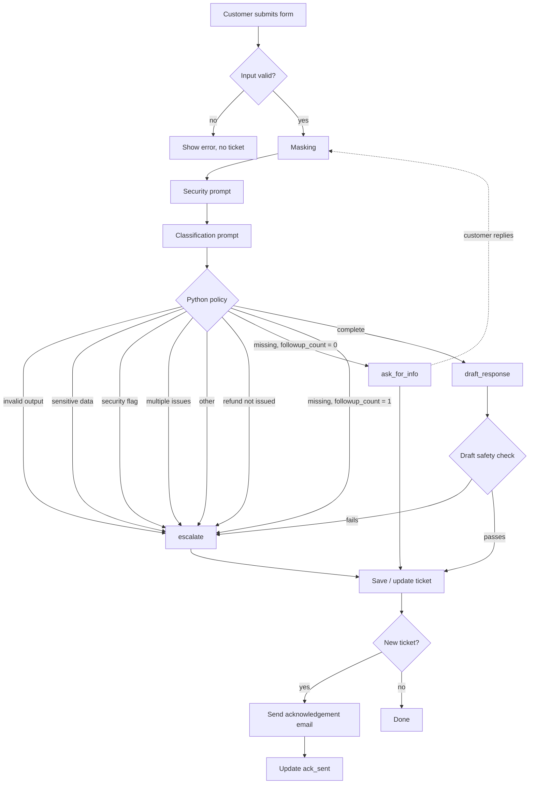
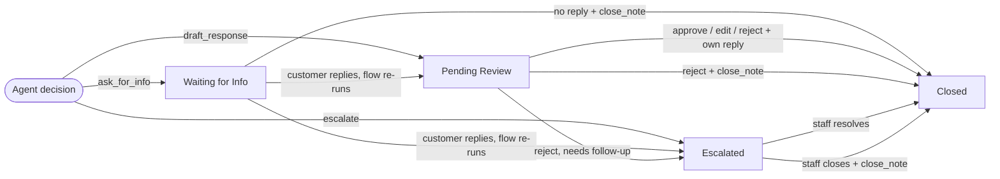

# Project Plan: Wallet Support Triage

## Workflow

### Agent flow

---

### Ticket lifecycle

---

| Action | Status |
|---|---|
| ask_for_info | Waiting for Info |
| draft_response | Pending Review |
| escalate | Escalated |